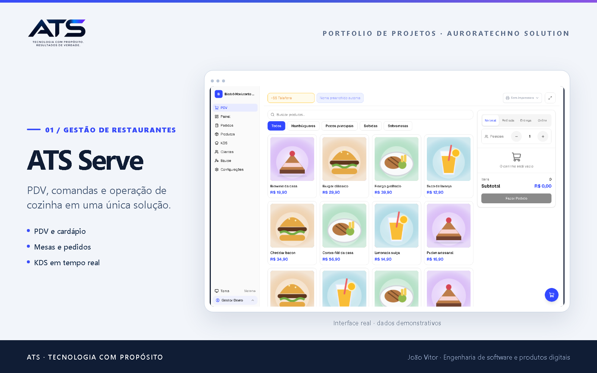
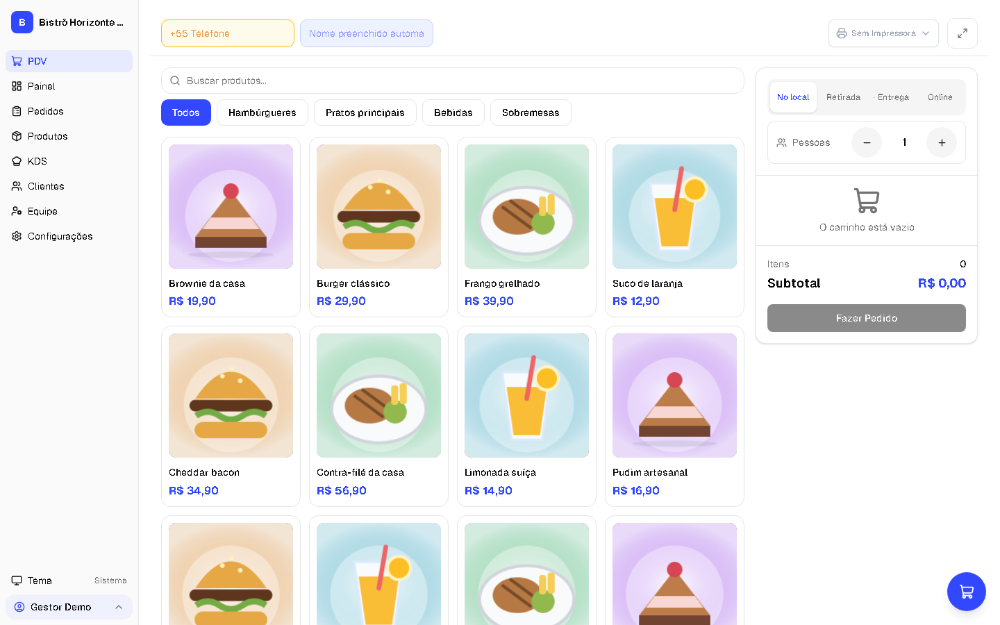
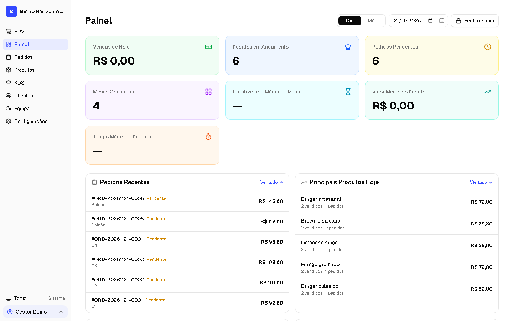
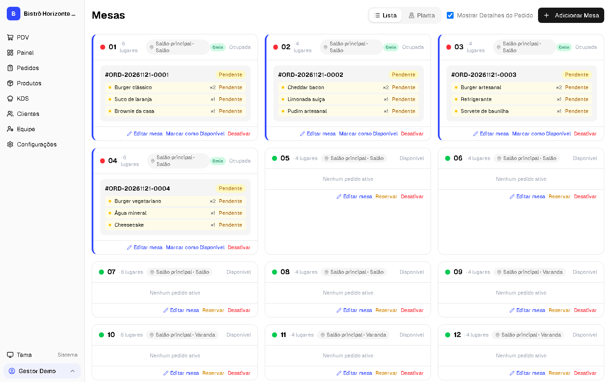
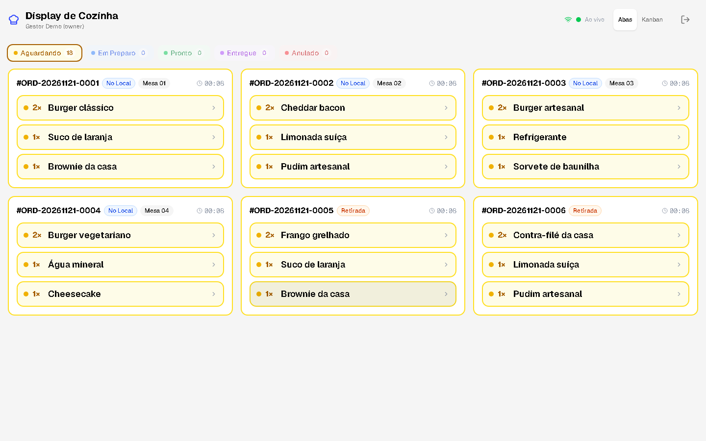
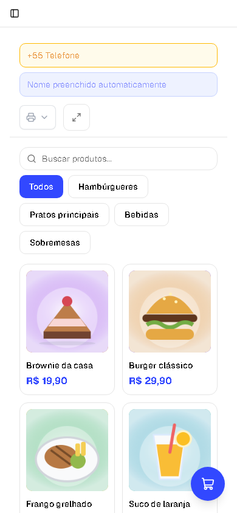

# ATS Serve Public

**Gestão de restaurantes, atendimento, comandas e cozinha.**

[Português](#visão-geral) · [English summary](#english-summary)



## Visão geral

ATS Serve é uma adaptação mantida pela AuroraTechno Solution do projeto open source [FloCafe](https://github.com/FreeOpenSourcePOS/FloCafe), orientada à operação de restaurantes e à experiência do mercado brasileiro.

O objetivo é reunir atendimento no balcão e salão, acompanhamento dos pedidos, organização de mesas, catálogo e fluxo de cozinha. O núcleo de operação local utiliza arquitetura offline-first.

## Diferenciais trabalhados pela ATS

- Identidade visual, nomenclatura de produto e experiência própria.
- Adaptação de primeira execução, configuração regional e experiência em português brasileiro.
- Registro de pagamento PIX declarado, sem alegar integração bancária homologada.
- Ajustes na interface de pagamentos, recibos e navegação.
- Isolamento de serviços remotos herdados e preservação da operação local.

## Evidências visuais

As cinco capturas abaixo foram obtidas executando este snapshot público, com dados fictícios. A capa apresenta a identidade do projeto. Não representam instalações de clientes ou homologação comercial.

### Ponto de venda


### Gestão e mesas



### Cozinha e atendimento mobile



## Arquitetura

| Camada | Tecnologias |
| --- | --- |
| Interface | Next.js, React, TypeScript |
| API local | Node.js, Express |
| Runtime | Electron |
| Persistência | SQLite |
| Cozinha | KDS local |

## Executar a demonstração local

Requisitos: Node.js 22.12 ou posterior, npm e internet para instalar dependências. Ambiente de referência: Windows. Não é necessário banco externo nem credencial ATS.

No CMD, na raiz do repositório:

```cmd
npm ci
npm --prefix frontend ci
npm run build
npm run build:frontend
npm run demo
```

Abra http://127.0.0.1:13001 para o PDV e http://127.0.0.1:13002 para a cozinha. A primeira execução abre a configuração de uma loja fictícia. O servidor está restrito a 127.0.0.1 e utiliza dados temporários de teste, sem ler o perfil instalado. Encerre com Ctrl+C.

Testes selecionados: `npm run test:public` e `npm run test:url-allowlist`.

Validação local em 21/11/2026: builds de backend e frontend aprovados; primeira execução brasileira (73/73), PIX (104/104), pagamentos, integração KDS e validação de URLs aprovados. Demonstração Playwright com 16 produtos, 12 mesas, seis pedidos e zero erros de página.

## Escopo e limites

Este repositório é um snapshot sanitizado do piloto brasileiro anterior à integração comercial da ATS. Inclui código do núcleo local e frontend, com histórico novo. Não inclui histórico privado, serviço de licenciamento comercial, administração de publicação, bancos existentes, registros operacionais ou artefatos de distribuição. Atualizações remotas, serviços de suporte e telemetria estão desabilitados.

Não constitui versão comercial certificada, serviço de pagamentos, integração bancária homologada ou instalador de produção.

## Créditos e licença

- Base original: [FloCafe](https://github.com/FreeOpenSourcePOS/FloCafe).
- Copyright (c) 2025–2026 FloCafe Contributors.
- Licença MIT e atribuição da base preservadas em [LICENSE](LICENSE) e [THIRD_PARTY_NOTICES.md](THIRD_PARTY_NOTICES.md).
- Adaptação ATS Serve: AuroraTechno Solution, João Vitor Silva Carvalho Costa.
- As marcas ATS e os materiais de apresentação próprios não são automaticamente licenciados pela licença do código-base.

## English summary

ATS Serve is an AuroraTechno Solution adaptation of the MIT-licensed FloCafe project. This public portfolio snapshot focuses on offline-first restaurant workflows, Brazilian localization, order and table management, kitchen display and payment UX. It contains local demonstration source code without private infrastructure or production data. Screenshots show synthetic demonstrations, not commercial deployments or payment certification.
